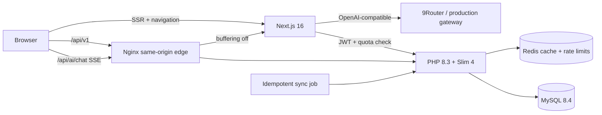

# HomeScope SG

HomeScope SG is an independent, full-stack Singapore property portal case study. It is designed around the core engineering problems in the PropNex Senior Fullstack Engineer role: fast multi-filter search, map viewport queries, SSR property pages, secure accounts, a guarded AI property advisor, caching, data synchronisation and reproducible delivery.

> Portfolio disclaimer: HomeScope uses synthetic listings, agents and transactions. It is not affiliated with or endorsed by PropNex Limited.

## Reviewer quick start

```bash
cp .env.example .env
docker compose up --build
```

Open [http://localhost:8080](http://localhost:8080). The first API boot creates the schema and deterministically seeds 300 listings. Demo login: `demo@homescope.sg` / `DemoPass123!`.

The Next.js UI also has a small fallback dataset, so `pnpm install && pnpm dev` remains visually reviewable while the API is offline.

## Architecture



- `apps/web`: App Router, TypeScript, Tailwind CSS, shared components, TanStack Query, TanStack AI, React Hook Form/Zod, Google Maps and a MapLibre/OpenStreetMap fallback with marker clustering.
- `apps/api`: thin Slim controllers, services/repositories, PDO prepared SQL, JWT/refresh rotation and OpenAPI.
- `infra`: Nginx same-origin reverse proxy; Docker Compose supplies PHP, MySQL and Redis without host installs.

## Product walkthrough

1. `/search` keeps filters in the URL so pages are bookmarkable and server-renderable.
2. `bbox=west,south,east,north` drives a MySQL spatial-index query. List mode uses an opaque cursor to power infinite scroll rather than offset pagination.
3. `/listings/{slug}` returns the listing, agent and transaction history and renders metadata, canonical URL and JSON-LD on the server.
4. Registration/login issues a 15-minute JWT. The seven-day random refresh token is hashed at rest, stored in an HttpOnly cookie and rotated on use.
5. `/engineering` explains the vertical slice and makes performance/security trade-offs visible to a technical reviewer.
6. The floating HomeScope AI drawer is locked to authenticated users, streams through TanStack AI and can only query synthetic listings through two read-only tools.

## AI property advisor

HomeScope AI uses `@tanstack/ai`, `@tanstack/ai-react` and the official OpenAI-compatible adapter against 9Router model `cx/gpt-6-luna`. Create a dedicated 9Router key named `homescope-local`, then set these server-only values in `.env`:

```dotenv
NINE_ROUTER_BASE_URL=http://host.docker.internal:20128/v1
NINE_ROUTER_MODEL=cx/gpt-6-luna
NINE_ROUTER_API_KEY=<dedicated-homescope-key>
```

Do not use a `NEXT_PUBLIC_*` name for the key. Docker maps `host.docker.internal` to the host gateway on Linux. Production can point the same variables at a secured OpenAI-compatible gateway; there is no automatic provider fallback.

Before any model call, PHP validates the JWT and applies Redis quotas of 10 messages/minute and 100/day per user. A deterministic injection guard and a separate strict-schema classifier then allow only property search, listing comparison, market explanation and HomeScope product help. The advisor can call only `search_listings` and `get_listing_detail`; both validate arguments and return synthetic catalogue data. See [the AI architecture and security notes](docs/ai-advisor.md).

## API examples

```bash
curl 'http://localhost:8080/api/v1/listings?property_type=Condo&bedrooms=2&max_price=3000000&bbox=103.70,1.25,103.95,1.45'
curl 'http://localhost:8080/api/v1/listings/marina-bay-residences'
curl 'http://localhost:8080/api/docs'
curl -X POST 'http://localhost:8080/api/v1/auth/login' -H 'content-type: application/json' -d '{"email":"demo@homescope.sg","password":"DemoPass123!"}'
```

Every error follows `{ code, message, details, request_id }`; the same request ID is returned in `X-Request-ID` and structured server logs.

## Search and database decisions

- `SPATIAL INDEX idx_location(location)` prunes viewport candidates before attribute filters.
- `idx_search(status, property_type, district, price, bedrooms, listed_at, id)` covers the common discovery path; focused price sorting has its own index.
- Cursor order follows the active sort field with `id DESC` as a stable tie-breaker. Unlike offsets, earlier inserts do not shift later pages.
- Search caches expire after 30 seconds and detail caches after 60 seconds. The sync job invalidates listing keys after a successful transaction.
- Run the representative query with `docker compose exec mysql mysql -uhomescope -phomescope homescope < apps/api/database/explain.sql` and keep the `EXPLAIN ANALYZE` output with performance review notes.

## Data sync

`php bin/sync-listings.php database/feed.example.json` models a scheduled upstream feed. It validates the complete payload, updates by stable `external_id` inside a transaction, reports machine-readable success/failure and is safe to rerun. In production, cron invokes it with a downloaded, verified feed.

## Tests and quality gates

```bash
pnpm install
pnpm typecheck && pnpm test && pnpm build
docker compose build api
docker run --rm -v "$PWD/apps/api:/app" -w /app composer:2 sh -lc 'composer install --prefer-dist --no-interaction --no-progress && vendor/bin/phpunit'
pnpm --dir apps/web test:e2e
```

CI repeats TypeScript, Vitest, Next production build, PHPUnit/PHPStan and both container builds. Acceptance targets are documented in [`docs/performance.md`](docs/performance.md).

## Maps

Set `NEXT_PUBLIC_GOOGLE_MAPS_API_KEY` in `.env` and restrict the key to your deployed hostname and Maps JavaScript API. Without a key—or if Google Maps cannot load—HomeScope automatically switches to MapLibre with OpenStreetMap tiles, clustered results and listing navigation. The MapLibre worker is self-hosted so the fallback also works with strict production asset policies.

## Deployment

The intended near-zero-cost deployment is one OCI Always Free VM with Docker Compose and a TLS reverse proxy. GitHub Actions builds versioned images in GHCR, connects with `OCI_HOST`, `OCI_USER`, `OCI_SSH_KEY`, deploys `/opt/homescope`, then smoke-tests `APP_DOMAIN/api/v1/health`. Secrets never enter Git or image layers.

## Intentional boundaries

This portfolio slice omits payments, human chat, CMS and real listing ingestion. The AI advisor has no web access, no code execution and no durable conversation database. Enquiries are non-sending UI. The focus is the quality of one representative end-to-end journey rather than feature count.

Property photography is loaded from [Unsplash](https://unsplash.com/) for demonstration and remains subject to its source terms.
