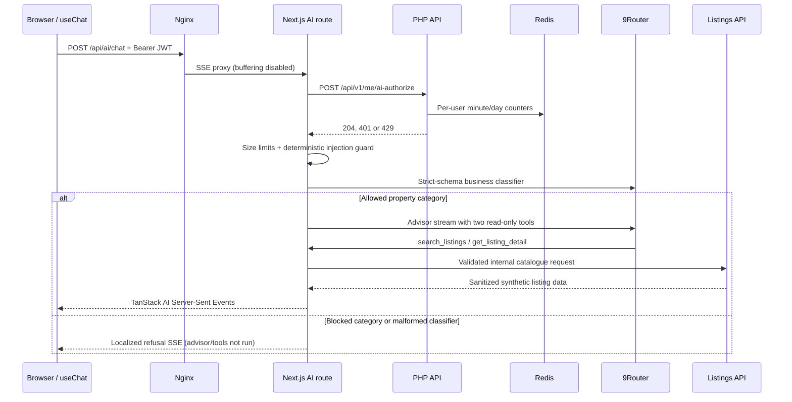

# HomeScope AI advisor

## Request flow



The client uses TanStack AI `useChat`, `fetchServerSentEvents` and `sessionStoragePersistence`. The thread key includes the authenticated email, survives page navigation and reloads in the same tab, and is deleted on logout. An active request is aborted on logout. A `401` refreshes the normal HttpOnly-cookie session and retries the AI request once.

## Local 9Router setup

1. Start 9Router on the host at port `20128`.
2. In 9Router, create a dedicated API key named `homescope-local`. Do not reuse a personal coding-agent key.
3. Copy `.env.example` to `.env` and replace only `NINE_ROUTER_API_KEY` with that key.
4. Start HomeScope with `docker compose up --build`.
5. Sign in with `demo@homescope.sg` / `DemoPass123!`, open **Ask HomeScope AI**, and ask: `Find a 2 bedroom condo under S$1.8M near an MRT`.

The key is server-only and `.env` is ignored by Git. Verify connectivity without printing the key:

```bash
curl --fail --silent \
  -H "Authorization: Bearer ${NINE_ROUTER_API_KEY}" \
  "http://127.0.0.1:20128/v1/models" >/dev/null
```

If 9Router is unavailable, `/api/ai/chat` returns `503`; the drawer retains its session history and offers retry. HomeScope never falls back to another provider or credential.

## Trust boundaries

- Authentication and Redis quota enforcement happen before classifier or advisor calls.
- Inputs are text-only, at most 2,000 characters per message, 20 messages and 12,000 characters of submitted context.
- Obvious rule-override, prompt/secret extraction and role-spoofing patterns are rejected before the classifier.
- The classifier has a strict Zod schema. Invalid output fails closed and never reaches the advisor.
- The classifier normalizes an allowed request into validated English; the advisor and all local refusal messages answer in English only.
- Only `property_search`, `listing_comparison`, `market_explanation` and `product_help` continue. Coding, politics, general knowledge, personalized legal/financial advice and prompt injection are refused.
- The advisor receives only the current allowed user message plus validated pathname/filter data. Previously blocked content is not trusted conversation context.
- Tools are an allowlist of two server-side read-only functions. Tool schemas reject unknown keys, arbitrary URLs, invalid slugs, unsupported property types and result limits above eight.
- Tool output removes agent contact data, creates only same-origin `/listings/{slug}` links and is validated again before listing cards render.
- Model text is rendered as escaped React text, never raw HTML. Listing cards are constructed only from validated tool output.
- Logs include request ID, category, model, latency, tool name, result count and usage. They omit messages, JWTs, system prompts and API keys.

## Quotas and errors

`POST /api/v1/me/ai-authorize` requires a Bearer access token. Redis counters are isolated by `user_id`:

- 10 requests per UTC minute (`90s` TTL)
- 100 requests per UTC day (`90,000s` TTL)

The AI route uses the existing API error envelope: `{ code, message, details, request_id }`. It returns `401` for authentication, `429` for quota, `422` for invalid input and `503` when authorization or 9Router is unavailable.

## CI and tests

- PHPUnit covers Bearer authentication, per-user quotas, minute/day buckets and Redis TTL values through the counter-store contract.
- Vitest covers injection corpora, strict classifier output, allowed categories, provider error mapping, tool argument/slug restrictions, locked/authenticated UI and session cleanup.
- Playwright intercepts the OpenAI-compatible SSE response, so CI never needs a 9Router key. It covers direct guest denial, authenticated streaming and history surviving `/search` ↔ `/engineering` navigation.

The live local smoke test is intentionally separate because it requires the developer-owned dedicated 9Router key.
